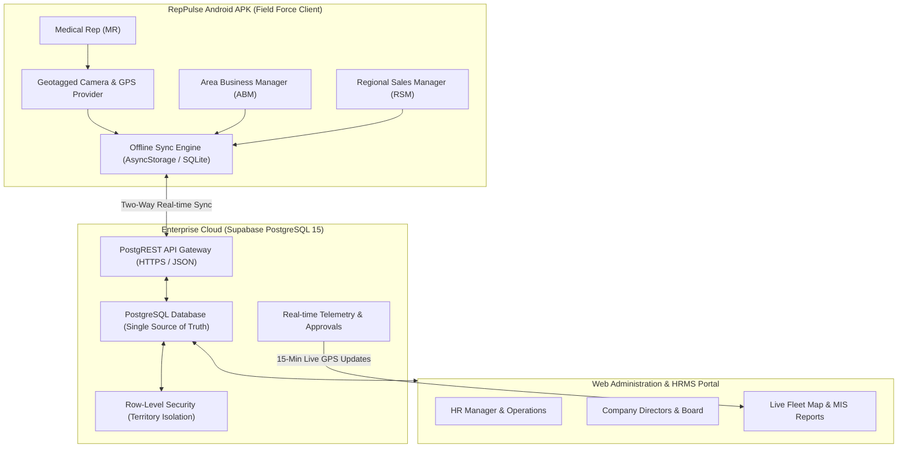
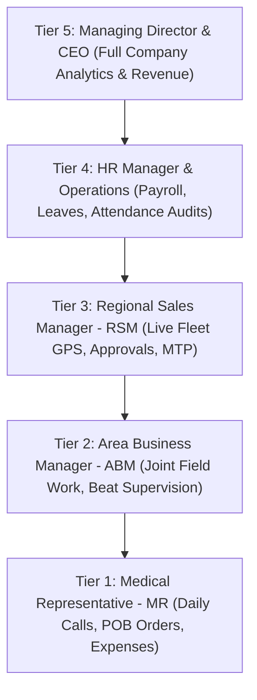
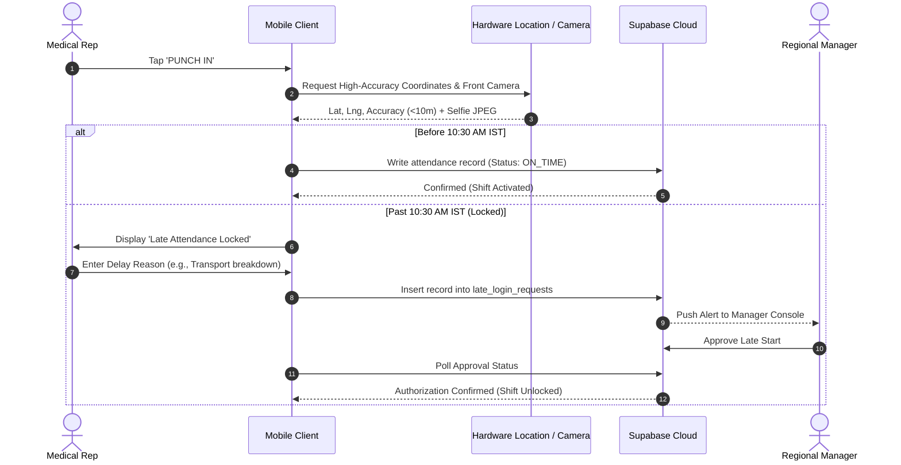

# RepPulse Pharma SFA — Complete APK Architecture & Functional Blueprint

**Document Version:** 2.5 (Production Release `v1.7.4`)  
**Target Platform:** Android (Native APK via React Native / Expo)  
**Backend & Database:** Supabase Enterprise Cloud (PostgreSQL 15 + RLS + PostgREST)  
**Web Console:** Admin & Management Portal (React 18, Vite, Tailwind CSS)  
**Primary Field Geographies:** Barak Valley & Northeast India (Silchar, Karimganj, Hailakandi, Aizawl, Dharmanagar)

---

## 1. Executive Summary & Architecture Overview

**RepPulse Pharma SFA** is an enterprise-grade Field Force Automation and Mobile CRM platform built specifically for pharmaceutical sales operations. Engineered to solve acute field challenges in multi-district territories, RepPulse enforces **anti-fraud geotagged attendance, 15-minute background location telemetry, doctor/chemist visit auditing (DCR), Monthly Tour Plan (MTP) governance, and real-time managerial oversight**.

The APK operates on a **True Offline-First architecture**: Medical Representatives (MRs) can log doctor calls, detail products, capture sample distributions, and book chemist orders even in remote hill pockets with zero cellular reception. When connectivity is restored, the synchronization engine flushes cached transactions to the Supabase cloud database using deterministic, collision-resistant event identifiers.

---

## 2. Business Value & Problem Matrix

| Traditional Manual / Legacy Challenge | The RepPulse Pharma SFA Solution |
| :--- | :--- |
| **Fake Attendance / Buddy Punching** | **Triple-Lock Verification:** Live front-camera selfie + hardware GPS satellite lock (< 10m accuracy) + Android Mock Location detection lockout. |
| **Late Field Reporting** | **Strict 10:30 AM IST Cutoff:** Reporting locks past 10:30 AM; requires multi-tier manager authorization (RSM/HR) to unlock daily operations. |
| **Field Deviation & Proxy Visits** | **100m Doctor Geofencing + 15-Min Telemetry:** Call submission is blocked unless the MR is physically within 100 meters of the doctor's registered clinic GPS coordinates. |
| **Connectivity Dropouts in Rural Beats** | **Offline-First Cache:** Full local CRUD operations; transactions queue locally and sync automatically without manual retry. |
| **Unplanned Route Deviations** | **Tour Plan Governance:** Reps follow an approved calendar of daily routes; date swaps require formal RSM authorization. |
| **Manual Travel Claim Disputes** | **Standard Fare Chart (SFC):** Fares and Daily Allowances (DA) calculate automatically based on HQ, Ex-station, or Outstation classifications. |

---

## 3. Five-Tier Organizational Hierarchy & Access Control

1. **Tier 1: Medical Representative (MR)** — *e.g., Satyam Shil (`NLCL-0005`), Pranjal Malakar (`NLCL-0004`)*  
   * Territory-isolated doctor lists (Silchar vs Karimganj vs Dharmanagar).
   * Morning geotagged attendance, approved MTP beat execution, chemist POB booking, daily call reporting (DCR), and TA/DA expense logging.
2. **Tier 2: Area Business Manager (ABM)**  
   * Field supervision, joint doctor call logging, secondary sales monitoring.
3. **Tier 3: Regional Sales Manager (RSM)** — *e.g., Bodrud Jaman Sadiol (`NLCL-0003`)*  
   * Multi-division oversight across Cachar, Karimganj, Hailakandi, and Mizoram.
   * Real-time live fleet tracking map, 10:30 AM late login authorizations, MTP deviation approvals, and expense claim sign-offs.
4. **Tier 4: HR Manager** — *e.g., Shakir Ahmad (`NLCL-0002`)*  
   * Central employee directory control, leave ledgers, monthly payroll calculations.
5. **Tier 5: Managing Director & CEO** — *e.g., Samsuj Jaman Sadiol (`NLCL-0001`)*  
   * Strategic overview, executive revenue dashboards, target vs achievement analytics.

---

## 4. Detailed Functional Modules of the APK

### 4.1 Authentication & Territory Isolation
* **Login Form:** Registered 10-digit mobile number + 4-digit security PIN (`1234`).
* **Territory Scoping:** When logged in, the APK fetches the representative's assigned Primary HQ and Extended Fields. Satyam only sees Cachar/Silchar data; Pranjal only sees Karimganj/Dharmanagar data.
* **Auto Session Recovery:** Persistent cached session tokens with automatic 11:59 PM end-of-day expiry.

### 4.2 Anti-Fraud Geotagged Attendance & 10:30 AM Cutoff

### 4.3 15-Minute Background Location Telemetry
* Powered by `expo-task-manager` and `expo-location`.
* Operates continuously during shift hours without draining battery (adaptive GPS interval).
* Records latitude, longitude, speed, heading, and battery level into `location_telemetry`.
* Managers can view rep paths on the web portal's **Live Fleet Map**.

### 4.4 Monthly Tour Programme (MTP) & Calendar Sync
* **Database Driven:** Loads monthly schedules directly from `tour_plans` table.
* **Auto-Default Beat:** When the rep punches in, the scheduled town/beat (e.g., *Kalain Ex-station* or *Silchar Central HQ*) automatically populates.
* **Reschedule Governance:** Reps cannot swap dates unilaterally; any change requires submitting a formal request that routes to the RSM.

### 4.5 Doctor Directory & On-Field GPS Onboarding
* Master directory classified by priority: **Tier A+** (Weekly), **Tier A** (Bi-weekly), **Tier B** (Monthly).
* **On-Field Onboarding (`+ Add Doctor`):**
  * MR captures Doctor Name, Specialty, Qualifications, Chamber Address, and target visits.
  * Captures the doctor's exact clinic GPS coordinates on the spot, creating a permanent 100m geofence for future audits.

### 4.6 Daily Call Reporting (DCR) with 100-Meter Geofencing
* **Geofence Check-in:** The APK computes the Haversine distance between rep GPS and clinic coordinates:
  $$\text{Distance} = 2R \cdot \arcsin\left(\sqrt{\sin^2\left(\frac{\Delta \text{lat}}{2}\right) + \cos(\text{lat}_1)\cos(\text{lat}_2)\sin^2\left(\frac{\Delta \text{lng}}{2}\right)}\right)$$
  Check-in is permitted only if $\text{Distance} \le 100\text{ meters}$.
* **Product Detailing & Visual Aid:** In-app visual aid presentation cards for detailing formulations (R-DSR, U-CURE, PROCALD3, etc.).
* **Sampling Ledger:** Captures exact sample strips and promotional inputs handed over.
* **Prescription Support:** Attaches nearby chemist support tags to measure return on investment.

### 4.7 Chemist POB (Personal Order Booking)
* Selects registered chemist from the territory database.
* Product catalog displays live commercial rates: **MRP, PTR (Price to Retailer), PTS (Price to Stockist)**, and GST.
* Applies active commercial schemes (e.g., *10 + 1 Free*).
* Generates instant digital Purchase Orders (PO) routed to authorized local stockists.

### 4.8 Standard Fare Chart (SFC) & Travel Expenses
* Automatic calculation based on the approved operational route:
  * **HQ Working:** Standard TA ₹30–₹45, Daily Allowance (DA) **₹250/day**.
  * **Ex-station Working:** Standard TA ₹135–₹195, Daily Allowance (DA) **₹450/day**.
  * **Outstation Working:** Standard TA ₹420–₹540, Daily Allowance (DA) **₹750/day**.
* Receipt camera upload for hotel lodge charges, toll, and courier.
* Direct submission to manager approval queue.

### 4.9 Leave Ledger & Statutory Holiday Calendar
* Real-time balance ledger: **Casual Leave (CL: 12), Sick Leave (SL: 12), Earned Leave (EL: 15)**.
* Integrated Assam 2026 gazetted holiday calendar prevents reps from being marked absent on statutory festivals.

### 4.10 Conflict-Free Offline Synchronization
* **Local Storage:** SQLite / AsyncStorage transaction queue.
* **Idempotent Identifiers:** Every record carries a deterministic key:
  $$\text{Key} = \text{Type} \mathbin{\Vert} \text{EmployeeCode} \mathbin{\Vert} \text{Timestamp}$$
  *(e.g., `att_in_NLCL-0005_2026-11-20T09-32-15`)*
* Automatic background synchronization occurs without duplicate entries when connectivity resumes.

---

## 5. Database Schema & Table Topology (Supabase Cloud)

The backend runs on PostgreSQL 15 with 14 production tables:

| Table Name | Description | Key Fields |
| :--- | :--- | :--- |
| **`employees`** | Staff credentials, roles & territories | `id`, `employee_code`, `name`, `role`, `phone`, `pin`, `headquarter`, `territory` |
| **`attendance`** | Daily punch-in/out records | `id`, `employee_code`, `date`, `punch_in_time`, `selfie_url`, `latitude`, `longitude`, `work_type` |
| **`late_login_requests`**| 10:30 AM cutoff authorization log | `id`, `employee_code`, `date`, `attempted_time`, `reason`, `status`, `reviewed_by` |
| **`tour_plans`** | Monthly Tour Programme (MTP) | `id`, `employee_code`, `date`, `city`, `route_id`, `route_type`, `status` (`APPROVED`) |
| **`tour_plan_reschedule_requests`** | Route deviation requests | `id`, `employee_code`, `original_date`, `new_date`, `reason`, `status` |
| **`routes`** | Operational beat definitions | `id`, `code`, `name`, `parent_hq`, `route_type`, `distance_km`, `standard_fare`, `da_allowed` |
| **`doctors`** | Prescribers & clinic geofences | `id`, `name`, `specialty`, `clinic_name`, `area`, `district`, `latitude`, `longitude`, `tier` |
| **`visits`** | Daily Call Reporting (DCR) | `id`, `employee_code`, `doctor_id`, `check_in_time`, `brands_detailed`, `samples_given`, `feedback` |
| **`firms`** | Retail chemists & stockists | `id`, `name`, `firm_type`, `district`, `dl_number`, `contact_person`, `phone` |
| **`products`** | Commercial product master | `id`, `brand_name`, `generic_name`, `formulation`, `mrp`, `ptr`, `pts`, `gst_rate` |
| **`orders`** | POB chemist purchase orders | `id`, `order_number`, `chemist_id`, `items`, `total_amount`, `supplying_stockist` |
| **`expenses`** | Daily TA/DA travel expense claims | `id`, `employee_code`, `date`, `route_id`, `distance_km`, `ta_amount`, `da_amount`, `status` |
| **`sfc_routes`** | Standard Fare Chart master | `id`, `from_location`, `to_location`, `distance_km`, `standard_fare`, `da_allowed` |
| **`leave_balances`**| Employee leave ledger | `id`, `employee_code`, `casual_leave_available`, `earned_leave_available`, `sick_leave_available` |
| **`holidays`** | Statutory regional holiday list | `id`, `name`, `date`, `day_of_week`, `type` (`Gazetted`) |
| **`location_telemetry`** | 15-minute background location log | `id`, `employee_code`, `timestamp`, `latitude`, `longitude`, `battery_level` |

---

## 6. Technical Specifications & Mobile Build Stack

| Component | Specification |
| :--- | :--- |
| **Mobile Runtime** | React Native `0.74.5` / Expo SDK `51.0.0` |
| **Language & Typing** | TypeScript `5.3.3` (100% Type-Safe, zero compile errors) |
| **Build System** | EAS (Expo Application Services) Cloud / Local Gradle |
| **Build Artifact** | Universal Standalone Android APK (`reppulse.apk`) |
| **Target Architecture** | `arm64-v8a`, `armeabi-v7a`, `x86_64` |
| **Min Android Version** | Android 8.0 Oreo (API Level 26) |
| **Target Android Version** | Android 14 / 15 (API Level 34/35) |
| **Database Network Protocol** | PostgREST / Supabase RESTful API via HTTPS TLS 1.3 |
| **Device Hardware Requirements** | Runs smoothly on low-cost 2GB/3GB RAM Android smartphones |

---

## 7. Operational Deployment Summary

1. **Live Database Connectivity**: Every operational module is connected directly to cloud Supabase tables with live seed data.
2. **Zero Maintenance Rebuilds**: Because the APK connects over the air to Supabase REST endpoints, **adding new doctors, changing tour plans, adjusting standard fares, or introducing new products does not require rebuilding or reinstalling the APK**. Updates reflect on all representatives' phones immediately.
3. **Distribution Ready**: The codebase is committed and pushed across all official GitHub remotes:
   * `reppulse/master` (`shakirahmad878/reppulse-pharma-sfa`)
   * `origin/master` (`shakirahmad878/pharma-assam-website`)
